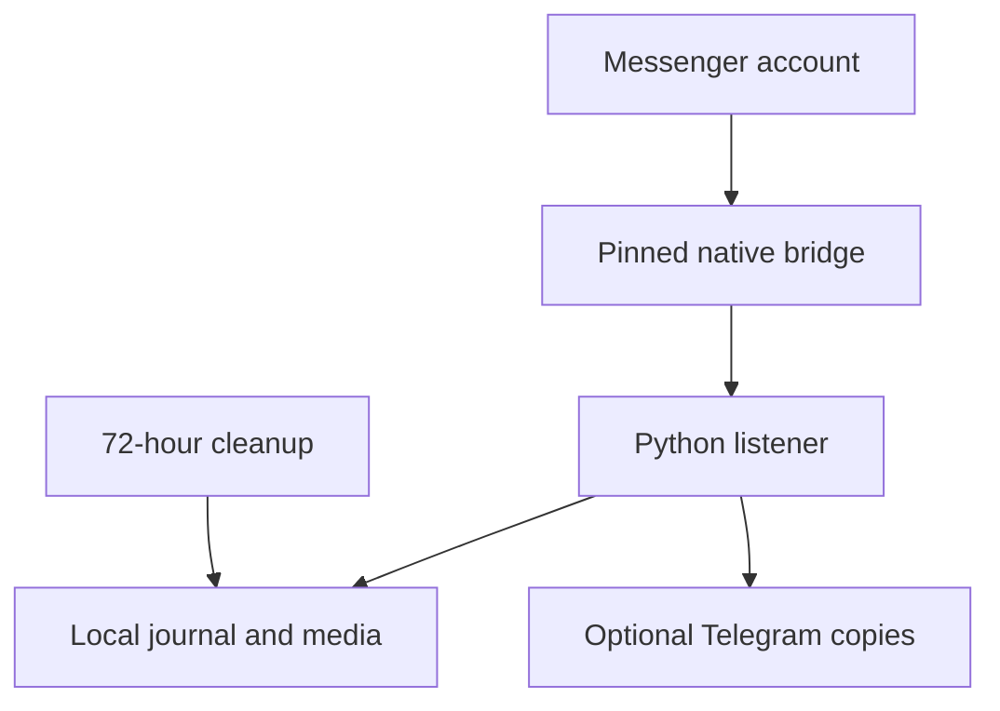

<div align="center">


**A self-hosted archive for the conversations happening now.**

Capture live Messenger messages and media, track observed unsends, and optionally
organize Telegram copies into a topic for each conversation. An optional admin
dashboard manages a small shared workspace with one Telegram bot.

[](#requirements)
[](#requirements)
[](#quick-start)
[](#deploy-on-oracle-cloud)
[](LICENSE)

[Admin dashboard](#admin-dashboard--one-shared-bot) · [Quick start](#quick-start) · [Oracle Cloud](#deploy-on-oracle-cloud) · [Telegram](#telegram-forwarding) · [Server setup](SERVER_SETUP.md) · [Troubleshooting](docs/TROUBLESHOOTING.md) · [Contributing](CONTRIBUTING.md)

</div>

---

## What it does

| Feature | Behavior |
| :--- | :--- |
| **Incoming capture** | Other people's text, attachments, replies, mentions, edits, reactions, and observed unsends. Messages sent by the logged-in account are excluded. |
| **Regular + encrypted chats** | A pinned native bridge handles both transports. |
| **Downloaded media** | Save supported images, video, GIFs, stickers, audio, voice messages, and files locally. |
| **Deleted-message view** | Inspect content captured before a deletion, including original text and the latest captured edit. |
| **Telegram topics** | Optionally forward copies into a topic for each Messenger conversation. |
| **72-hour local retention** | Expire local content and media automatically. Telegram copies stay in Telegram. |
| **Content-only logs** | Read/delivery receipts, typing, and presence do not become chat records. |
| **Unattended operation** | Run on Ubuntu with systemd, restart handling, and a separate cleanup timer. |
| **Admin dashboard** | Manage up to six isolated account instances over HTTPS, replace cookies, and control capture. |
| **One-time setup links** | Invite friends to connect through a temporary server browser and receive their Telegram invitation. List active links and disable them from the dashboard. |
| **One shared bot** | Expiring Telegram invites, administrator approval, destination checks, and a private conversation topic map per person. |

> [!IMPORTANT]
> This is an **unofficial, best-effort Messenger integration**, not a Meta product.
> It saves events the transport delivers. It cannot recover content deleted
> before capture, and it deliberately does not fetch old chat history.

## How it works



The standalone Python adapter uses the standard library. The optional dashboard
adds Flask, cryptography, and Gunicorn. Docker builds the native bridge
from exact upstream revisions and verifies pinned SHA-256 digests. The adapter
exposes connection, receive, download, and bounded contact-lookup operations.
It exposes no Messenger send, mark-read, or delete method.

See [transport provenance](THIRD_PARTY.md) and [native development](docs/NATIVE_BUILD.md).

## Requirements

- A Linux host with Docker; Ubuntu with systemd for the server installer.
- Linux **amd64** or **arm64** for the pinned native binary.
- Git for a checkout; Python 3 on the host for the service installer.
- An existing signed-in Facebook session for your own account.
- Outbound Messenger connectivity and optional Telegram connectivity. The standalone logger requires no incoming app port; the optional HTTPS dashboard uses TCP 8443.

Windows users can connect to a Linux server over SSH or use a Linux environment
such as WSL. Bash wrappers and `fcntl` locking are not native Windows tools.
Development without Docker requires Python **3.11+**; native compilation requires
Git and Go **1.26.10**.

## Admin dashboard + one shared bot


*Dashboard preview with synthetic demo accounts.*

The optional dashboard adds account setup, encrypted cookie storage, status,
start/stop/restart controls, cookie replacement, and Telegram invitations. Each
person receives notifications in their own private chat with the same bot;
Messenger conversations remain separated into topics within that chat.

The **Usage** tab adds live server resources, per-account storage, observed
monthly transfer and editable Oracle Always Free budgets. It labels partial
local estimates and optional console-entered totals separately from billing.
See [usage monitoring](docs/USAGE.md).

The administrator creates a **single-use, 15-minute invitation**. The recipient
opens it in Telegram, then the administrator approves that Telegram identity
before starting the account. Workers receive individual gateway credentials;
the shared bot token stays in the central service.

For an existing Ubuntu installation with `messenger-logger:modern` already built:

```bash
sudo bash server/install-dashboard.sh --host YOUR_PUBLIC_IP_OR_HOSTNAME
```

This installs the dashboard alongside the existing logger. It prompts for an
administrator password and prints the HTTPS URL and initial certificate
fingerprint. Allow TCP 8443 in Oracle networking and the host firewall, then
verify the fingerprint before trusting the initial self-signed certificate.
No native rebuild is required.

To move an existing systemd-managed logger into the dashboard after installation:

```bash
sudo messenger-dashboard-admin import-existing \
  --env-file /home/ubuntu/messenger.env \
  --data-dir /home/ubuntu/messenger-data \
  --name "My account"
```

The import verifies the existing bot/private chat, stops the original logger
before copying its archive/device state, and starts a managed account with the
same destination. The original directory and its cleanup timer remain available
for rollback. Earlier failed notifications are not replayed.

**[Full dashboard setup, pairing, HTTPS, migration, and recovery guide →](docs/DASHBOARD.md)**

## Quick start

### 1. Get the source

```bash
git clone https://github.com/LysaKrysa/messenger-logger.git messenger-modern
cd messenger-modern
cp messenger.env.example ../messenger.env
chmod 600 ../messenger.env
mkdir -p ../messenger-data
chmod 700 ../messenger-data
```

Keep the environment file and runtime data outside the source checkout:

| Path | Contents |
| :--- | :--- |
| `messenger-modern/` | Source checkout |
| `messenger.env` | Private account and Telegram settings |
| `messenger-data/` | Private archive, media, and encryption-device state |

### 2. Configure your account

```bash
nano ../messenger.env
```

Replace the placeholders in `FB_SESSION_JSON` with your own session cookies.
The required names are `c_user`, `xs`, and `datr`. Find them locally in your
signed-in browser's developer tools under Facebook's Application/Storage cookies.
A cookie object or browser-export array is accepted.

```dotenv
FB_SESSION_JSON={"c_user":"YOUR_NUMERIC_ACCOUNT_ID","xs":"YOUR_XS_COOKIE","datr":"YOUR_DATR_COOKIE"}
LOGGER_E2EE=true
LOGGER_TIMEZONE=Europe/Warsaw
TELEGRAM_ENABLED=false
```

The example account ID is intentionally invalid until replaced. Keep the JSON
on one line. Docker reads this as an env file: do not add `export` or extra
quotes around the entire JSON value. Never commit the real environment file.
Password login, CAPTCHA solving, and automated checkpoint handling are not supported.

### 3. Build and validate

```bash
sudo docker build -t messenger-logger:modern .
sudo docker run --rm messenger-logger:modern --self-test
sudo docker run --rm \
  --env-file "$(realpath ../messenger.env)" \
  messenger-logger:modern --check-config
```

The first build downloads Go sources and compiles the bridge. It can take several
minutes on a small VM. `--self-test` checks the binary and local RPC without login.
`--check-config` checks cookie shape without authenticating; it does not prove
that the session is valid.

### 4. Test in the foreground

```bash
sudo docker run --rm --name messenger-logger-modern-test --stop-timeout 30 \
  --env-file "$(realpath ../messenger.env)" \
  --mount "type=bind,source=$(realpath ../messenger-data),target=/data" \
  --mount "type=bind,source=$PWD,target=/app,readonly" \
  messenger-logger:modern
```

Wait for `Messenger listener ready (regular and encrypted)`. Ask another person
to send you a **new** message, then inspect it from another terminal:

```bash
sudo ./show-messages
```

Ask that person to unsend the test message, then inspect the captured deletion:

```bash
sudo ./show-deleted
```

Press **Ctrl+C in the foreground listener's terminal** when the test is complete.

## Deploy on Oracle Cloud

This guide uses an Ubuntu VM in **Oracle Cloud Infrastructure (OCI)**. The logger
runs on the VM independently of your PC or SSH session.

### 1. Create an Ubuntu VM

In the OCI Console, select your **home region**, then open **Compute → Instances
→ Create instance**. Use the following starting configuration:

| Setting | Suggested value |
| :--- | :--- |
| Image | Canonical **Ubuntu 24.04 LTS**, matching the selected architecture |
| Shape | **VM.Standard.A1.Flex** (arm64), when eligible capacity is available |
| Starting size | **1 OCPU / 6 GB RAM**, within your remaining free allocation |
| Boot volume | **50 GB**, within your remaining storage allowance |
| Capacity type | On-demand |
| Networking | A public subnet with internet connectivity and a public IPv4 address |
| SSH access | Add your public key or download the generated private key |

A1 gives more build/runtime headroom than the 1 GB E2 micro option. Both arm64
and amd64 are supported by this project's native build. If A1 capacity is
unavailable, try another availability domain in the home region or wait.

**Free-tier check — 4 November 2026:** Oracle documents an A1 allowance equivalent
to **2 OCPUs / 12 GB RAM total** and **200 GB combined boot/block storage**.
These are tenancy-wide allowances, not per-VM quotas. Verify remaining capacity,
eligibility, and the creation summary before launching; trial credits and
chargeable extras are separate. Oracle may reclaim idle Always Free instances.

See Oracle's current [Always Free resources](https://docs.oracle.com/en-us/iaas/Content/FreeTier/freetier_topic-Always_Free_Resources.htm)
and [instance creation guide](https://docs.oracle.com/en-us/iaas/Content/Compute/Tasks/launchinginstance.htm).

For networking, the **VCN with Internet Connectivity** wizard can create the
subnet, internet gateway, and routes. Allow SSH **TCP 22** from your own public
IP/CIDR in the relevant network security group or subnet security list. Keep
normal outbound internet access for builds and the Messenger/Telegram transports.
The logger needs no inbound application port.

### 2. Connect over SSH

Once the instance is running, copy its public IP from the Console. Replace
`YOUR_VM_PUBLIC_IP` below; keep the private key on your own computer.

Windows PowerShell, from the directory containing your key:

```powershell
ssh -i ".\ssh-key.key" ubuntu@YOUR_VM_PUBLIC_IP
```

Linux/macOS:

```bash
chmod 600 ./ssh-key.key
ssh -i ./ssh-key.key ubuntu@YOUR_VM_PUBLIC_IP
```

If SSH times out, check the VM's public IP, public-subnet route, SSH ingress
rule, and your current client IP before changing the application.

### 3. Install Docker and host tools

If Docker already works on the VM, keep that installation and ensure Git and
Python 3 are present. For a **fresh Ubuntu 24.04** VM, expand these commands:

<details>
<summary><strong>Install Docker Engine from its official Ubuntu apt repository</strong></summary>

```bash
sudo apt-get update
sudo apt-get install -y ca-certificates curl git python3
sudo install -m 0755 -d /etc/apt/keyrings
sudo curl -fsSL https://download.docker.com/linux/ubuntu/gpg -o /etc/apt/keyrings/docker.asc
sudo chmod a+r /etc/apt/keyrings/docker.asc

sudo tee /etc/apt/sources.list.d/docker.sources >/dev/null <<EOF
Types: deb
URIs: https://download.docker.com/linux/ubuntu
Suites: noble
Components: stable
Architectures: $(dpkg --print-architecture)
Signed-By: /etc/apt/keyrings/docker.asc
EOF

sudo apt-get update
sudo apt-get install -y docker-ce docker-ce-cli containerd.io docker-buildx-plugin
sudo systemctl enable --now docker
sudo docker run --rm hello-world
```

These commands use Ubuntu 24.04's `noble` repository and automatically select
arm64/amd64. For another release or an existing/conflicting installation, follow
[Docker's current Ubuntu instructions](https://docs.docker.com/engine/install/ubuntu/).

</details>

### 4. Configure and build the logger

Run on the VM as the `ubuntu` user:

```bash
cd ~
git clone https://github.com/LysaKrysa/messenger-logger.git messenger-modern
cd messenger-modern
cp messenger.env.example ../messenger.env
chmod 600 ../messenger.env
mkdir -p ../messenger-data
chmod 700 ../messenger-data
nano ../messenger.env
```

Fill in your own `FB_SESSION_JSON`. Keep `LOGGER_E2EE=true` for encrypted chats.
Telegram is optional; configure its token, chat ID, and topic settings only if
you want forwarding. The private env file and data folder stay outside Git.

```bash
sudo docker build -t messenger-logger:modern .
sudo docker run --rm messenger-logger:modern --self-test
sudo docker run --rm \
  --env-file "$(realpath ../messenger.env)" \
  messenger-logger:modern --check-config
```

Let the initial Go download/build finish. The image builds the correct native
architecture on the VM. Before installing the service, run the
[foreground test](#4-test-in-the-foreground), verify a fresh message, and stop
that test with Ctrl+C.

### 5. Enable unattended operation

```bash
cd ~/messenger-modern
sudo bash server/install-service.sh
sudo systemctl status messenger-logger --no-pager
sudo journalctl -u messenger-logger -f
```

Wait for `Messenger listener ready (regular and encrypted)`. In another SSH
session, check messages and the retention timer:

```bash
cd ~/messenger-modern
sudo ./show-messages
sudo ./show-deleted --run all
sudo systemctl list-timers messenger-retention.timer --no-pager
```

**Ctrl+C in the journal viewer only closes that viewer.** You can then close
SSH and turn off your PC. Systemd starts the logger at boot; the VM itself
must remain running. Local content still expires after 72 hours and Telegram
copies remain untouched.

### 6. Maintain the VM

```bash
sudo docker stats --no-stream messenger-logger
df -h ~/messenger-data
sudo journalctl -u messenger-retention -n 20 --no-pager
```

Monitor memory, disk space, provider limits, and instance availability. After
refreshing cookies in `~/messenger.env`, restart with
`sudo systemctl restart messenger-logger`. Use the [server guide](SERVER_SETUP.md)
for stopped services, container-name conflicts, source updates, and manual cleanup.

## Run continuously on a server

After the foreground test passes:

```bash
sudo bash server/install-service.sh
sudo systemctl status messenger-logger --no-pager
sudo journalctl -u messenger-logger -f
```

The installer enables startup at boot and installs a separate retention timer.
**Ctrl+C in `journalctl -f` closes only the log viewer.** The service keeps running
after SSH closes or your PC shuts down. The server itself must remain powered on.

Temporary failures restart after 60 seconds, subject to a start-rate limit.
Authentication/checkpoint problems, invalid settings, account mismatches,
incompatible binaries, and storage failures stop with status **78** for manual
attention. The installer refuses to take over an unmanaged existing container.

Known Signal-library diagnostic lines on native stdout are filtered without
retaining their text. Other JSON/encoding failures stop the affected bridge
with retryable exit status 1, allowing systemd to restart it. Structural protocol
errors and authentication/configuration failures still require manual attention.

The [server guide](SERVER_SETUP.md) covers installation, container-name conflicts,
cookie refresh, source updates, service controls, and cleanup checks.

## Read your archive

| Command | Result |
| :--- | :--- |
| `sudo ./show-messages` | Captured messages from the latest run |
| `sudo ./show-deleted` | Messages observed as deleted/unsent in the selected run |
| `sudo ./show-deleted --run all` | Deleted records across retained runs |
| `sudo ./show-messages --limit 100` | Increase the display limit |
| `sudo ./show-messages --json` | Structured records and attachment metadata |
| `sudo ./show-messages --include-ids` | Include IDs for local troubleshooting |

Views use a read-only, query-only SQLite connection. They do not log in or
request history. Available names replace IDs in readable output; missing names
appear as `Unknown participant`. `--run all` does not bypass retention.

<details>
<summary><strong>Example deleted-message view — synthetic data</strong></summary>

```text
DELETED / UNSENT
Conversation: Weekend plans
Sender: Alex (@alex.example)
Sent: 2026-11-04T12:30:00+01:00
Deletion observed: 2026-11-04T12:31:00+01:00
Text: Here is the photo from today.
```

The real view also lists available attachment paths and statuses. If content was
never captured, the view explicitly says it is unavailable.

</details>

## Telegram forwarding

Telegram is optional and disabled by default. Create a bot with **@BotFather**,
send `/start` to the bot, and obtain the intended destination chat ID.
Edit your private `messenger.env`:

```dotenv
TELEGRAM_ENABLED=true
TELEGRAM_BOT_TOKEN=YOUR_BOT_TOKEN
TELEGRAM_CHAT_ID=YOUR_CHAT_ID
TELEGRAM_MODE=deleted
TELEGRAM_SEND_MEDIA=true
TELEGRAM_TOPICS=true
```

For the service installation, reload settings with:

```bash
sudo systemctl restart messenger-logger
```

### One topic per conversation

- **Private bot chat:** enable **Threaded mode** for the same bot in BotFather.
- **Group:** use a supergroup with **Topics** enabled and grant the bot
  administrator access with **Manage Topics**.
- Also set `TELEGRAM_TOPICS=true` in the logger. BotFather and the logger have
  separate settings.

Topic IDs persist across restarts. Conversations with equal names remain
separate. Text, files, edit/reaction notices, and observed deletions use the
corresponding topic. Topics are created only when a new eligible event needs
forwarding; existing Telegram messages are not reorganized.

### Choose what is forwarded

| Setting | Effect |
| :--- | :--- |
| `TELEGRAM_MODE=deleted` | Observed deletions using captured content |
| `TELEGRAM_MODE=all` | Also newly accepted messages, files, edits, and reactions |
| `TELEGRAM_SEND_MEDIA=true` | Upload available saved attachments as documents |
| `TELEGRAM_VIEW_ONCE=true` | Separately opt in to immediate view-once copies |

Notices use formatted text, resolved names, timestamps, and attachment captions.
Each deleted message produces **one Telegram notice**:

| Captured content | Telegram delivery |
| :--- | :--- |
| Text and metadata | One formatted message |
| One attachment, including a voice message | Original file with the message details in its caption |
| Multiple attachments or long text with a file | One ZIP containing the original files and `message.txt` |
| Text longer than one Telegram message | One downloadable `message.txt` |

Telegram documents include its native **download/save controls**; voice recordings
are sent as downloadable files. The relay waits for pending local downloads before
posting the notice. Failed downloads are described in that same notice. If the
combined file exceeds Telegram's upload limit, one notice explains that the files
remain local. Document uploads preserve the saved bytes. Ambiguous sends are not
automatically retried, avoiding duplicate delivery.

Capture excludes the logged-in account's messages and quoted copies of its text.
Edits, reactions, and deletions must relate to a known incoming message. A deletion
that arrives before its original waits briefly in memory for attribution. Existing
owner records are hidden from the message views and forwarding; older archive files
continue through the normal 72-hour expiry. In `all` mode, capture and a later
deletion remain separate events, with one notification for each.

### Check Threaded mode

```bash
sudo ./check-telegram-topics
```

This performs a fresh **read-only** check of the configured bot's public username,
Telegram capability, destination type, and logger settings. It prints no token
or cookies, sends no messages, creates no topics, and changes no local data.
A setup problem returns exit status 2 with an explanation.

A failed capability check has a 30-second cooldown. Restarting clears it.
With deletion-only forwarding, ask another person to send a fresh message and
**unsend it after capture**. Your own messages are excluded.
Earlier failed notices are not replayed simply because settings changed.

For topic-ID repair and unconfirmed creation, see [Telegram troubleshooting](docs/TELEGRAM.md).

## Media and view-once content

Supported attachments download only for newly admitted messages. The default
limit is **25 MiB per attachment**, configurable up to **100 MiB**. The native
bridge authenticates and decrypts encrypted downloads. Files use private
permissions, sanitized names, and atomic writes; size and SHA-256 are recorded.

Consumer/Raven view-once image/video wrappers and regular ephemeral labels are
supported when usable download metadata reaches the client. Capture is best
effort: an empty/unsupported event cannot yield a photo the client never received.
View-once expiry is not automatically treated as an unsend.

Ordinary links, link-preview images, locations, old media, and interrupted jobs
are not downloaded automatically. Pending jobs become `interrupted` at restart.
Regular-chat images may be previews rather than original-resolution uploads.

## Three-day local retention

**Local content expires 72 hours after capture.** Checks run at startup and about
every five minutes. The independent server timer also runs while capture is
stopped. After a VM outage, overdue cleanup runs when the server starts again.

| Removed locally at expiry | Kept for continued operation |
| :--- | :--- |
| Text, original/latest edits, deletion records | Cookie configuration |
| Related journal events and daily-log records | Encryption-device state |
| Downloaded media and attachment metadata | Account association |
| Structured copies of expired quoted replies | Minimal numeric Telegram topic routing IDs |
| Obsolete labels and attempt records | Already sent Telegram messages and files |

An edit, reaction, or unsend does not extend the original message's lifetime.
Newer records in the same daily file remain. The earlier automatic migration
snapshot is removed because it could preserve expired content. Cleanup calls
no Telegram or Messenger deletion method.

External copies, backups, and snapshots need their own retention. Application
cleanup is not a forensic disk wipe. Unknown-format legacy files use their
modification time when a record timestamp cannot be read.
See [storage details](docs/STORAGE.md).

## Configuration

The complete template is [messenger.env.example](messenger.env.example).

| Variable | Default | Purpose |
| :--- | :--- | :--- |
| `FB_SESSION_JSON` | Required | Cookie object or browser-export array |
| `LOGGER_E2EE` | `true` | Enable encrypted transport |
| `LOGGER_TIMEZONE` | `Europe/Warsaw` | IANA timezone for dates and daily files |
| `LOGGER_MEDIA_MAX_MB` | `25` | Attachment limit, integer 1–100 MiB |
| `TELEGRAM_ENABLED` | `false` | Enable forwarding explicitly |
| `TELEGRAM_MODE` | `deleted` | `deleted` or `all` |
| `TELEGRAM_BOT_TOKEN` | Required if enabled | BotFather token; keep private |
| `TELEGRAM_CHAT_ID` | Required if enabled | Intended destination chat ID |
| `TELEGRAM_TOPICS` | `false` | One topic per conversation |
| `TELEGRAM_SEND_MEDIA` | `true` | Upload available saved attachments |
| `TELEGRAM_VIEW_ONCE` | `false` | Immediate view-once copies |
| `DATA_DIR` | `/data` | Container-internal data path |
| `BRIDGE_BIN` | `/usr/local/bin/messenger-bridge` | Container-internal binary path |

Host view/media wrappers accept `LOGGER_DATA_DIR` and `LOGGER_IMAGE`; the service
installer and Telegram checker accept `LOGGER_ENV_FILE`. Defaults are sibling
`messenger-data` and `messenger.env` paths. Local retention is fixed at three days.

## Coverage and limits

- **Muted chats:** no mute filter is applied; delivered events are still accepted.
- **Groups:** supported group messages keep their conversation and participant identity.
- **Encrypted chats:** require encrypted transport readiness and working device state.
- **Future events only:** messages created before each process startup are rejected,
  even if replayed in a new envelope. Every run starts with fresh counters.
- **Offline gaps:** missed events are not guaranteed to replay; history is not fetched.
- **Names:** contact metadata and bounded read-only lookups improve labels.
  Placeholders such as `username` are rejected; names remain best effort.
- **Other callbacks:** friend requests, games, polls, calls, scheduled plans, and
  separate group membership/admin/theme callbacks are not ported. User-visible
  system messages supplied as text can still be captured.

Test a fresh direct message, muted-chat message, group message, and supported
attachment on your deployment. The unofficial protocol can change independently.

## Development and tests

```bash
python3 -m unittest discover -s tests -v
```

No Python packages are required. Tests use synthetic cookies/events and mocked
Telegram requests. They send no Messenger messages or Telegram notices.
A native RPC check is skipped unless a compatible binary is supplied:

```bash
BRIDGE_TEST_BIN=/absolute/path/to/messenger-bridge \
  python3 -m unittest discover -s tests -v
```

There are **151 checks** covering event filtering, future-only admission, deletion
tracking, journal recovery, media integrity, names, Telegram formatting/topics,
retention, and restart exit codes. [VALIDATION.md](VALIDATION.md) distinguishes
offline checks from live-account/server behavior.

CI includes Python tests and a native Docker build/smoke test. Live account
authentication is not a CI check.

## Project map

| Area | Files |
| :--- | :--- |
| Listener + native RPC | `logger.py`, `bridge_rpc.py` |
| Storage + retention | `event_store.py`, `retention.py`, `view_messages.py` |
| Media + identities | `media_saver.py`, `identities.py`, `contact_names.py` |
| Telegram | `telegram_relay.py`, `telegram_format.py`, `telegram_topics.py` |
| Read-only diagnosis | `check_telegram_topics.py`, `check-telegram-topics` |
| Native build | `build_native.py`, `install_bridge.py`, `native/` |
| Server operation | `server/`, `SERVER_SETUP.md` |
| Tests + documentation | `tests/`, `docs/`, `VALIDATION.md` |

## Contributing and security

Read [CONTRIBUTING.md](CONTRIBUTING.md) for the workflow and [SECURITY.md](SECURITY.md)
before attaching diagnostics. Keep real cookies, tokens, messages, media, device
files, and database copies out of commits, issues, and pull requests.

Use only accounts and conversations you are authorized to archive. Telegram
forwarding sends selected content to your configured destination; local expiry
does not revoke those copies. This project is not affiliated with Meta or Telegram.

## License and credits

Original project code and documentation are **AGPL-3.0-or-later**; see [LICENSE](LICENSE).
Upstream components retain their own licenses and notices. The transport builds
on [fbchat-v2](https://github.com/m008v/fbchat-v2),
[mautrix-meta](https://github.com/mautrix/meta), and their dependencies.

The former Railway/fbchat-v1 application is not bundled into this standalone
source tree. See [THIRD_PARTY.md](THIRD_PARTY.md) and [NOTICE](NOTICE) for exact
revisions, checksums, attribution, and license copies.
